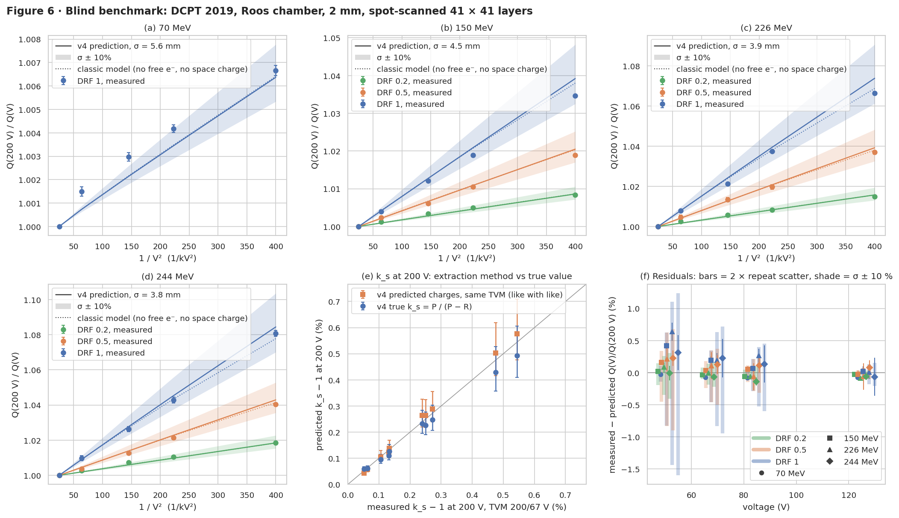

# Benchmark: DCPT 2019 recombination measurements

Generated by `python validation/benchmark_dcpt2019.py` (122 s). The measurement set-up
is a Roos chamber (2 mm gap, r = 7.8 mm) at 2 cm water depth in Varian ProBeam 10 × 10 cm² layers
of 41 × 41 spots. Charges were collected at 5 voltages × 3 dose-rate factors (DRF) × 4 energies.
Reference: Christensen et al 2020, Phys. Med. Biol. 65 115003.

**This is a blind prediction. No model input is adjusted to the measured charges.** The table
below lists every input and where it comes from.

| Input | Value | Source |
|---|---|---|
| Spot map, dose per layer, spot duration | 41 × 41 at 2.5 mm; `dose_Gy`; `time_s` | Delivery records in the dataset |
| Dead time between spots | 2 ms | Assumed (not in the data) |
| Spot σ at the chamber | 70 MeV: 5.60 mm · 150 MeV: 4.50 mm · 226 MeV: 3.91 mm · 244 MeV: 3.80 mm | ProBeam in-air σ at isocentre, 5.6 mm (70 MeV) to 3.8 mm (244 MeV), [Lee et al 2020](https://pmc.ncbi.nlm.nih.gov/articles/PMC7170285/), log-interpolated |
| Spot σ uncertainty | ± 10% | Site-to-site agreement of ProBeam in-air σ, [Langner et al 2017](https://doi.org/10.1002/acm2.12078) |
| µ⁺, µ⁻, α, D± | 1.36, 2.1 cm²/Vs; 1.6e-6 cm³/s; Einstein | Boag; `Gas.air(particle="proton")` at each measurement's T and p |
| W_air | 34.44 eV | ICRU 90 (protons) |
| Free electrons | mobility 830 cm²/Vs, attachment rate γ(E) | Götz et al. 2013, as tabulated by Fenwick & Kumar 2023 |
| Space charge | on | Gauss's law for the ion charge (the default model) |
| Initial recombination | one track per energy and voltage in the 3D track model | N0 from the stopping power in air; Gaussian radius from the IonTracks v3 LET table (20 µm floor for protons) |

The dose per layer agrees with the chamber's own 200 V reading × s_w,air ≈ 1.13, so it is
probably that reading. It sets the ionisation density, which the voltage dependence cannot
constrain, so it isn't a tuned parameter.

## Results

1. **Voltage dependence of the charge.** The prediction reproduces Q(V)/Q(200 V) for all 10
   settings to within 0.64 % (RMS 0.17 %). Of the 40 ratios below 200 V,
   37 lie inside the σ ± 10% band widened by twice their repeat scatter. The
   classic model (no free electrons, uniform field) deviates by up to 0.31 % (RMS
   0.11 %). The earlier approach (a continuous beam at the dataset's dose rate)
   deviates by up to 1.27 %.
2. **k_s at 200 V, extracted like for like.** Applying the same TVM (200/67 V) to measured and
   predicted charges, the mean relative difference in k_s − 1 is +0 %
   (spread 8 %, nominal σ).
3. **True k_s versus TVM.** The model's true k_s − 1, from P / (P − R), is on average
   0.95 times the value the TVM extracts from the same predicted charges
   (range 0.86–1.37). The TVM assumes that 1/Q falls
   as 1/V², but three parts of the model do not:
   - initial recombination goes as 1/V;
   - the free-electron fraction grows with the field;
   - the spot structure varies the local dose rate across the chamber and in time.

   This is a model result, not a measurement, and it needs an independent check: a
   higher-voltage series or a calorimetric reference.
4. **Which physics does what.** Deviation of Q(V)/Q(200 V) over the 40 ratios below 200 V:

   | Model | max | RMS |
   |---|---|---|
   | default (free electrons + space charge) | 0.64 % | 0.17 % |
   | free electrons only | 0.36 % | 0.10 % |
   | space charge only | 0.72 % | 0.20 % |
   | classic (neither) | 0.31 % | 0.11 % |

   Free electrons alone change little. Space charge makes the agreement worse. At 50 V and the
   highest dose rate the space-charge parameter η = e q d⁴ / (ε₀ µ⁺ V²) reaches about 3 at a spot centre,
   so the model adds loss at low voltage, and the predicted voltage dependence steepens beyond
   what was measured. Two things set the size of that term:
   - the ion parameters: η ∝ 1/µ⁺, and Boag's µ⁺ = 1.36 cm²/Vs is at the low end of published
     values (the free-electron models of Götz, Kranzer and Fenwick & Kumar use 1.87 cm²/Vs);
   - the laterally uniform (1D) field, while a spot is only about twice as wide as the gap.

   The Risø benchmark shows the same space-charge excess in its field ratios. Choosing between
   these needs independent data, not a fit to these charges. It is an open item.

## Initial recombination from the 3D track model

k_s − 1 of one track (default physics) at each voltage, the classic-physics value at 200 V, and
the IonTracks v3 values that were used before v4 had a track model. b is the Gaussian track radius.

| E (MeV) | b (µm) | 50 V | 67 V | 83 V | 125 V | 200 V | 200 V, classic | 200 V, IonTracks v3 |
|---|---|---|---|---|---|---|---|---|
| 70 | 20 | 6.63e-04 | 5.73e-04 | 5.10e-04 | 3.96e-04 | 2.73e-04 | 3.14e-04 | 3.62e-04 |
| 150 | 20 | 3.80e-04 | 3.29e-04 | 2.92e-04 | 2.27e-04 | 1.57e-04 | 1.80e-04 | 2.07e-04 |
| 226 | 20 | 2.84e-04 | 2.46e-04 | 2.18e-04 | 1.69e-04 | 1.17e-04 | 1.35e-04 | 1.58e-04 |
| 244 | 20 | 2.77e-04 | 2.40e-04 | 2.13e-04 | 1.66e-04 | 1.14e-04 | 1.32e-04 | 1.51e-04 |

## Uncertainties

* **Measurement.** Error bars are the standard error of the repeat readings (two or three per
  voltage), floored at the 1e-4 reading resolution. The charges are not monitor-normalised and
  each voltage is a separate delivery, so the true uncertainty also contains the
  delivery-to-delivery reproducibility. That term is not in the data, and none is added.
* **Spot size.** A 10 % smaller σ raises the predicted k_s − 1 by
  13–23 %, and a 10 % larger σ lowers it by
  9–17 %. The effect is smallest at low dose
  rates, where initial recombination dominates. General recombination scales as α/σ², so a 10 %
  error in α acts like a 5 % error in σ. The band covers σ only.
* **Not propagated.** The spot sizes are from another ProBeam site, in air at isocentre. They are
  interpolated in energy between 70 and 244 MeV. Multiple scattering over 2 cm of water adds
  ≲ 0.3 mm in quadrature, which is negligible. The dead time matters only if it is shorter than
  the chamber memory (about 0.8 ms at 50 V).

## Checks on the set-up

* The dataset's `k_s` column is not reproduced by a 5-point linear fit in 1/V² (max difference
  9.5e-04), so it was derived some other way. TVM with 200/67 V applied to the raw charges
  reproduces the TVM point in Fig. 5(a) of the paper (for example 1.0054 at 244 MeV, DRF 1). Model
  and measurement are therefore compared with TVM on both sides.
* The fast evaluator (tabulated single-spot episodes) against the full `solve_field` at 244 MeV,
  DRF 1, 50 V: relative difference in 1 − f of 6.6e-04.

## Per setting

Values in brackets span σ ± 10%. "Max Δ" is the largest absolute deviation of
Q(V)/Q(200 V) over the five voltages, in percent. "Consistent" counts the ratios inside the band
widened by 2 × their repeat scatter.

| E (MeV) | DRF | spot (ms) | measured k_s (TVM) | predicted k_s (TVM) | predicted true k_s | dataset k_s | max Δ (%) | consistent | max Δ, continuous (%) |
|---|---|---|---|---|---|---|---|---|---|
| 70 | 1 | 22.3 | 1.0005 | 1.0004 (1.0004–1.0005) | 1.0006 (1.0005–1.0007) | 1.0006 | 0.08 | 2/4 | 0.33 |
| 150 | 0.2 | 20.1 | 1.0006 | 1.0006 (1.0005–1.0007) | 1.0006 (1.0005–1.0007) | 1.0005 | 0.06 | 4/4 | 0.08 |
| 150 | 0.5 | 8.2 | 1.0013 | 1.0014 (1.0011–1.0017) | 1.0013 (1.0011–1.0015) | 1.0013 | 0.16 | 4/4 | 0.30 |
| 150 | 1 | 4.2 | 1.0024 | 1.0026 (1.0022–1.0033) | 1.0023 (1.0019–1.0028) | 1.0025 | 0.42 | 4/4 | 0.69 |
| 226 | 0.2 | 13.8 | 1.0011 | 1.0011 (1.0009–1.0013) | 1.0010 (1.0008–1.0012) | 1.0008 | 0.09 | 3/4 | 0.19 |
| 226 | 0.5 | 5.4 | 1.0025 | 1.0026 (1.0022–1.0032) | 1.0023 (1.0019–1.0028) | 1.0019 | 0.21 | 4/4 | 0.44 |
| 226 | 1 | 2.8 | 1.0048 | 1.0050 (1.0042–1.0062) | 1.0043 (1.0036–1.0053) | 1.0038 | 0.64 | 4/4 | 0.48 |
| 244 | 0.2 | 13.0 | 1.0013 | 1.0012 (1.0010–1.0015) | 1.0011 (1.0009–1.0013) | 1.0008 | 0.14 | 4/4 | 0.41 |
| 244 | 0.5 | 5.2 | 1.0027 | 1.0029 (1.0024–1.0036) | 1.0025 (1.0021–1.0030) | 1.0020 | 0.23 | 4/4 | 0.66 |
| 244 | 1 | 2.6 | 1.0054 | 1.0058 (1.0048–1.0071) | 1.0049 (1.0041–1.0061) | 1.0041 | 0.31 | 4/4 | 1.27 |

## Notes and open questions

* **Chamber.** The paper states a Roos-type chamber with 2 mm electrode spacing. The dataset README
  on `origin/backend-benchmark` says "Advanced Markus, 2 mm", but the PTW Advanced Markus has a
  1 mm gap. That label should be corrected.
* **Dose rates.** The dataset's `dose_rate_*` columns equal D_field / (≈ 38 × t_spot) for every
  setting. That is higher than the effective dose rates in Fig. 3(a) of the paper by 1.5× (244 MeV)
  to 2.7× (70 MeV). The spot model uses neither: it uses the spot map, dose, spot duration and σ
  directly.
* **Would tighten the prediction.** DCPT's own spot sizes at 2 cm depth, the dead time between
  spots from the logs, and the delivery-to-delivery reproducibility of the charge readings.
* **Model inputs without independent data here.** The track radius (v3 LET table, floor 20 µm)
  and the free-electron attachment rate below 1000 V/cm (the Götz parameterisation is stated
  for ≥ 1000 V/cm and is extrapolated to 250 V/cm at 50 V).
