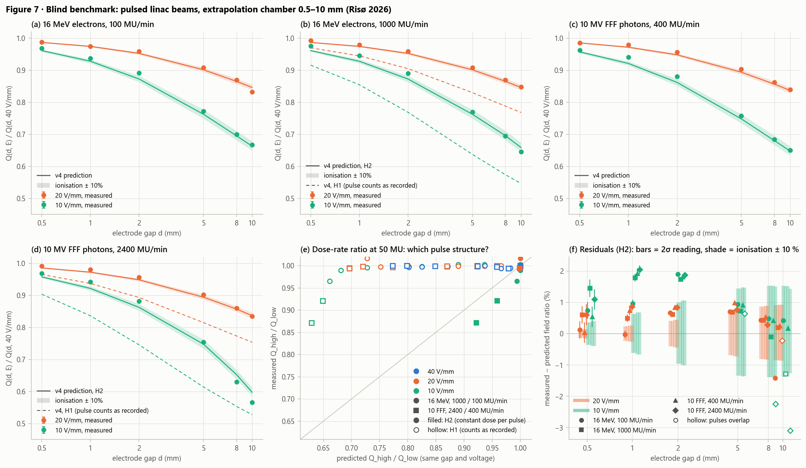

# Benchmark: pulsed linac beams, extrapolation chamber (Risø 2026)

Generated by `python validation/benchmark_risoe2026.py` (77 s). The data are from a
Varian linac at Risø (31.03.2026), copied from the IonTracks-AMM repository into
`validation/data/risoe2026/` (see its README):
- an extrapolation chamber (collecting electrode r = 15 mm) 71.4 cm from the source in a
  20 × 20 cm² field;
- 16 MeV electrons at 100 and 1000 MU/min, and 10 MV FFF photons at 400 and 2400 MU/min;
- gaps of 0.5–10 mm at 10, 20 and 40 V/mm, 50 MU per reading, both polarities.

Recombination here is large (up to 45 % at 10 mm and 10 V/mm). At the high dose rates and large
gaps, the ions of one pulse are still in the gap when the next pulse arrives. This makes it a
direct test of v4's handling of pulse overlap.

**This is a blind prediction. No model input is adjusted to the recombination data.**

| Input | Value | Source |
|---|---|---|
| Charge per reading | mean of the two polarities | Dataset (raw charges) |
| Ionisation per MU | 4.729e+09 (16 MeV), 3.918e+09 (10 FFF) ion pairs/cm³ | Slope of Q(d) at 0.5–1 mm, 40 V/mm, **low dose rate only**, divided by e × area; the model's own loss there (1.3%–2.9%) is removed |
| Ionisation uncertainty | ± 10% | Sensitivity band, not a derived uncertainty |
| Pulses per 50 MU, period | see below | `pulses_per_MU.csv` (09.04.2026, a different day) |
| Pulse width | 4 µs | Assumed; 2 and 6 µs change any field ratio by ≤ 4.6e-04 |
| Gas | 20 °C (assumed), 1014.38 hPa | `Gas.air`: µ⁺ 1.36, µ⁻ 2.1 cm²/Vs, α 1.6e-6 cm³/s |
| Collecting area | π × (15 mm)² | Implied by the dataset's `electrons_s_cm3` column |

The two observables need neither the gap offset nor an inverse-square correction:

1. **The field ratio Q(d, E) / Q(d, 40 V/mm)** for E = 20 and 10 V/mm, at fixed beam, dose rate and
   gap (48 values).
2. **The dose-rate ratio Q_high / Q_low** at the same gap and voltage (36 values). Both
   readings are 50 MU, so this tests the pulse structure.

## The pulse records: two readings

The high-dose-rate pulse counts are hard to believe as recorded. In the same file:
- **6 MV:** 36 pulses/MU from 5 to 200 MU/min (3 → 120 Hz); then about a third of that
  (11.5–11.7 pulses/MU) from 300 to 600 MU/min, where constant dose per pulse would need
  180–360 Hz (files 10406, 10408, 10409, 10412).
- **Other beams:** no counted rate in any beam exceeds ~122 Hz. The 4 MV and 10 FFF series show
  the same drop at the dose rate where the implied rate passes that ceiling.

The counter therefore appears to miss pulses above ~120 Hz. For the 16 MeV electrons the count
already drops at 600 MU/min (implied 99 Hz), so the file alone does not settle that beam.

- **H1** takes the counts as recorded. The high dose rates then have 2.3× (16 MeV) and 2.5× (10 FFF)
  the dose per pulse.
- **H2** keeps the low-dose-rate dose per pulse and scales the repetition rate with the dose rate.

H2 was set up from the pulse file before comparing with the charges, and both are reported.

| Beam | MU/min | recorded pulses per 50 MU | recorded rate (Hz) | H2 pulses per 50 MU | H2 rate (Hz) | dose per pulse in air, H1 (mGy) | H2 (mGy) |
|---|---|---|---|---|---|---|---|
| 16 MeV electrons | 100 | 496 | 17 | 496 | 17 | 2.15 | 2.15 |
| 16 MeV electrons | 1000 | 208 | 69 | 496 | 166 | 5.12 | 2.15 |
| 10 MV FFF photons | 400 | 371 | 50 | 371 | 50 | 2.38 | 2.38 |
| 10 MV FFF photons | 2400 | 146 | 116 | 371 | 297 | 6.06 | 2.38 |

## Results

1. **The dose-rate ratio decides between H1 and H2.** Under H2, the 31 ratios without
   pulse overlap are predicted to within 1.6 %. The largest of
   these is 16 MeV, 10 mm, 20 V/mm, which involves the
   flagged polarity pair (¹ below); all others are within
   1.1 %. The 5 overlap cases are item 4.
   Under H1 the deviations reach 31 %. At 40 V/mm the measured Q_high / Q_low is
   0.994–1.000 at every gap. H1 predicts it would fall to 0.773 at
   10 mm, because the dose per pulse would have changed. The recorded high-rate pulse counts are
   therefore wrong, and H2 is used below.
2. **Field ratios (H2).** All 48 ratios are reproduced to within
   3.1 % (RMS 1.1 %), with losses
   from 1 % to 45 %. 24 of 48 lie inside the ionisation band widened by twice the
   reading resolution. Under H1 the high-dose-rate ratios deviate by up to
   14 %.
3. **The residuals are systematic, not random.**
   - At gaps ≤ 2 mm, the measured loss is smaller than predicted (mean residual
     +1.0 %). Free electrons would do this: they are collected before
     attaching, and their share grows as the gap shrinks. v4 does not model free electrons yet.
   - At 5–10 mm, the mean residual is +0.1 %.
   - Where consecutive pulses overlap (4 gap/setting combinations at 10 V/mm, all at the
     high dose rates), the measured loss exceeds the prediction by up to
     3.1 %. At these points Boag's u reaches 2.4, where space charge
     (≈ 3.9 u for air) is certainly not negligible.
4. **Pulse overlap is predicted, but not all of it.** Under H2 the 10 FFF 2400 MU/min pulses come
   every 3.4 ms, against a positive-ion transit time
   of 7.4 ms at 10 mm and 10 V/mm. The dose per pulse is the same at both dose rates. The field
   ratio there is:
   - predicted: 0.648
     at 400 MU/min and 0.597
     at 2400 MU/min;
   - measured: 0.650
     and 0.566.

   The model gives 61% of the measured extra loss (dose-rate ratio
   0.922 against 0.872). Treating each pulse in isolation,
   as the AMM scripts do, predicts none of it. Two effects would widen the gap:
   - The H2 repetition rate is inferred (six times the 400 MU/min count), not measured. If that
     count is also low, the true rate is higher and the pulses overlap more.
   - Space charge is largest at exactly these points.

   A pulse count that resolves > 120 Hz would separate the two.

## Validity

- **Missing physics.** v4 has neither free electrons nor space charge. For pulses, the field of
  the separated charge relative to the applied field is e n₀ d / (ε₀ E) ≈ 3.9 u in air. It
  exceeds 1 wherever u ≳ 0.25, which includes most of the 5–10 mm points. That the field ratios
  still agree within a few per cent there supports Boag-type modelling for this regime. It is not
  evidence that space charge is negligible.
- **Numerics.** Going from 200 to 400 cells changes 1 − f by ≤ 5.1e-05 (relative) at the
  smallest and largest loss. The pulse width does not matter: pulses of 2–6 µs are much shorter
  than the transit times (≥ 90 µs).

## Uncertainties

- **Measurement.** Each charge is a single reading per polarity, recorded to 0.05 nC. The error
  bars use that resolution only (0.014 nC per reading). There are no repeats, so the
  reproducibility is unknown and not included.
- **Ionisation.** It comes from the low-dose-rate charges at the two smallest gaps. It sets the
  loss scale (roughly ∝ n₀), which the field ratios cannot constrain. The ± 10 % band shows
  that sensitivity.
- **Not propagated.** The pulse records are from another day (09.04.2026). The temperature is
  assumed, which affects α/µ by ~0.3 %/K. The area is taken from the dataset's own column.

## Per gap: field ratios

Values in brackets span the ionisation ± 10%. t_c/T is the positive-ion transit time at
10 V/mm over the pulse period (> 1: pulses overlap). u is Boag's parameter at 10 V/mm (H2).

| Setting | d (mm) | t_c/T | u | measured 20/40 | predicted 20/40 | measured 10/40 | predicted 10/40 | H1 10/40 |
|---|---|---|---|---|---|---|---|---|
| 16 MeV, 100 | 0.5 | 0.01 | 0.11 | 0.988 | 0.987 (0.985–0.988) | 0.969 | 0.961 (0.958–0.965) | = |
| 16 MeV, 100 | 1 | 0.01 | 0.22 | 0.974 | 0.974 (0.972–0.977) | 0.938 | 0.928 (0.922–0.934) | = |
| 16 MeV, 100 | 2 | 0.02 | 0.44 | 0.959 | 0.952 (0.948–0.957) | 0.892 | 0.873 (0.863–0.883) | = |
| 16 MeV, 100 | 5 | 0.06 | 1.10 | 0.908 | 0.901 (0.894–0.909) | 0.772 | 0.763 (0.749–0.777) | = |
| 16 MeV, 100 | 8 | 0.10 | 1.77 | 0.870 | 0.865 (0.857–0.874) | 0.700 | 0.695 (0.682–0.711) | = |
| 16 MeV, 100 | 10 | 0.12 | 2.21 | 0.832 ¹ | 0.846 (0.838–0.855) | 0.667 | 0.663 (0.649–0.678) | = |
| 16 MeV, 1000 | 0.5 | 0.06 | 0.11 | 0.993 | 0.987 (0.985–0.988) | 0.976 | 0.961 (0.958–0.965) | 0.916 |
| 16 MeV, 1000 | 1 | 0.12 | 0.22 | 0.979 | 0.974 (0.972–0.977) | 0.946 | 0.928 (0.922–0.934) | 0.855 |
| 16 MeV, 1000 | 2 | 0.24 | 0.44 | 0.959 | 0.952 (0.948–0.957) | 0.890 | 0.873 (0.863–0.883) | 0.769 |
| 16 MeV, 1000 | 5 | 0.61 | 1.10 | 0.908 | 0.901 (0.894–0.909) | 0.770 | 0.763 (0.749–0.777) | 0.637 |
| 16 MeV, 1000 | 8 | 0.97 | 1.77 | 0.870 | 0.865 (0.857–0.874) | 0.695 | 0.696 (0.682–0.711) | 0.574 |
| 16 MeV, 1000 | 10 | 1.22 | 2.21 | 0.848 | 0.846 (0.838–0.855) | 0.646 | 0.659 (0.645–0.674) | 0.546 |
| 10 FFF, 400 | 0.5 | 0.02 | 0.12 | 0.986 | 0.985 (0.984–0.987) | 0.963 | 0.957 (0.953–0.961) | = |
| 10 FFF, 400 | 1 | 0.04 | 0.24 | 0.979 | 0.972 (0.969–0.974) | 0.941 | 0.921 (0.915–0.928) | = |
| 10 FFF, 400 | 2 | 0.07 | 0.49 | 0.957 | 0.948 (0.944–0.953) | 0.880 | 0.862 (0.852–0.873) | = |
| 10 FFF, 400 | 5 | 0.18 | 1.22 | 0.904 | 0.894 (0.887–0.902) | 0.757 | 0.748 (0.735–0.763) | = |
| 10 FFF, 400 | 8 | 0.29 | 1.96 | 0.862 | 0.857 (0.848–0.866) | 0.685 | 0.681 (0.667–0.696) | = |
| 10 FFF, 400 | 10 | 0.36 | 2.44 | 0.840 | 0.837 (0.829–0.846) | 0.650 | 0.648 (0.635–0.663) | = |
| 10 FFF, 2400 | 0.5 | 0.11 | 0.12 | 0.991 | 0.985 (0.984–0.987) | 0.968 | 0.957 (0.953–0.961) | 0.903 |
| 10 FFF, 2400 | 1 | 0.22 | 0.24 | 0.981 | 0.972 (0.969–0.974) | 0.942 | 0.921 (0.915–0.928) | 0.836 |
| 10 FFF, 2400 | 2 | 0.44 | 0.49 | 0.957 | 0.948 (0.944–0.953) | 0.881 | 0.862 (0.852–0.873) | 0.745 |
| 10 FFF, 2400 | 5 | 1.09 | 1.22 | 0.902 | 0.894 (0.887–0.902) | 0.754 | 0.747 (0.734–0.762) | 0.614 |
| 10 FFF, 2400 | 8 | 1.75 | 1.96 | 0.860 | 0.857 (0.849–0.866) | 0.630 | 0.653 (0.639–0.668) | 0.553 |
| 10 FFF, 2400 | 10 | 2.19 | 2.44 | 0.834 | 0.836 (0.828–0.845) | 0.566 | 0.597 (0.585–0.612) | 0.527 |

¹ This reading's polarity pair (Q⁺/Q⁻ = 1.034) is far more asymmetric than any other reading at gaps ≥ 5 mm.
It is kept in the comparison.

## Dose-rate ratios

| Beam | d (mm) | E (V/mm) | measured | H2 | H1 |
|---|---|---|---|---|---|
| 16 MeV | 0.5 | 40 | 0.995 | 1.000 | 0.982 |
| 16 MeV | 0.5 | 20 | 1.000 | 1.000 | 0.966 |
| 16 MeV | 0.5 | 10 | 1.002 | 1.000 | 0.936 |
| 16 MeV | 1 | 40 | 0.994 | 1.000 | 0.966 |
| 16 MeV | 1 | 20 | 0.999 | 1.000 | 0.937 |
| 16 MeV | 1 | 10 | 1.002 | 1.000 | 0.890 |
| 16 MeV | 2 | 40 | 1.000 | 1.000 | 0.937 |
| 16 MeV | 2 | 20 | 0.999 | 1.000 | 0.890 |
| 16 MeV | 2 | 10 | 0.998 | 1.000 | 0.825 |
| 16 MeV | 5 | 40 | 0.998 | 1.000 | 0.871 |
| 16 MeV | 5 | 20 | 0.998 | 1.000 | 0.802 |
| 16 MeV | 5 | 10 | 0.996 | 1.000 | 0.728 |
| 16 MeV | 8 | 40 | 0.997 | 1.000 | 0.825 |
| 16 MeV | 8 | 20 | 0.997 | 1.000 | 0.752 |
| 16 MeV | 8 | 10 | 0.989 | 1.000 | 0.681 |
| 16 MeV | 10 | 40 | 0.997 | 1.000 | 0.802 |
| 16 MeV | 10 | 20 | 1.016 | 1.000 | 0.728 |
| 16 MeV | 10 | 10 | 0.965 | 0.994 | 0.661 |
| 10 FFF | 0.5 | 40 | 0.994 | 1.000 | 0.978 |
| 10 FFF | 0.5 | 20 | 1.000 | 1.000 | 0.958 |
| 10 FFF | 0.5 | 10 | 1.000 | 1.000 | 0.923 |
| 10 FFF | 1 | 40 | 0.997 | 1.000 | 0.958 |
| 10 FFF | 1 | 20 | 0.999 | 1.000 | 0.924 |
| 10 FFF | 1 | 10 | 0.999 | 1.000 | 0.870 |
| 10 FFF | 2 | 40 | 0.999 | 1.000 | 0.924 |
| 10 FFF | 2 | 20 | 0.999 | 1.000 | 0.870 |
| 10 FFF | 2 | 10 | 1.000 | 1.000 | 0.798 |
| 10 FFF | 5 | 40 | 0.999 | 1.000 | 0.848 |
| 10 FFF | 5 | 20 | 0.997 | 1.000 | 0.773 |
| 10 FFF | 5 | 10 | 0.994 | 0.999 | 0.696 |
| 10 FFF | 8 | 40 | 1.000 | 1.000 | 0.798 |
| 10 FFF | 8 | 20 | 0.998 | 1.000 | 0.720 |
| 10 FFF | 8 | 10 | 0.921 | 0.959 | 0.649 |
| 10 FFF | 10 | 40 | 1.000 | 1.000 | 0.773 |
| 10 FFF | 10 | 20 | 0.994 | 0.999 | 0.696 |
| 10 FFF | 10 | 10 | 0.872 | 0.922 | 0.629 |

## Notes on the source data

- `k_di` in the dataset is an inverse-square correction. It is 1 + d/890 mm on `main` of
  IonTracks-AMM, and 1 + d/714 mm after the "uniformity correction fix" on
  `test-structued-pulses`, which matches the stated 71.4 cm. It cancels in both observables and is
  used only in the ionisation calibration (≤ 0.14 %).
- The AMM scripts divide by 496 (16 MeV) and 371 (10 FFF) pulses at both dose rates, which amounts
  to H2. They then treat each pulse in isolation, so pulse overlap is missed.
- The dataset's `k_s` (AMM `fit_summary.csv`) comes from a linear fit of Q(d) at 0.5–1 mm and is
  below 1 in places. It is not used here.
- **Would tighten the benchmark.** A pulse count at the high dose rates with a detector that
  resolves > 120 Hz, the temperature, repeat readings, and an independent dose per MU at the
  chamber position.
