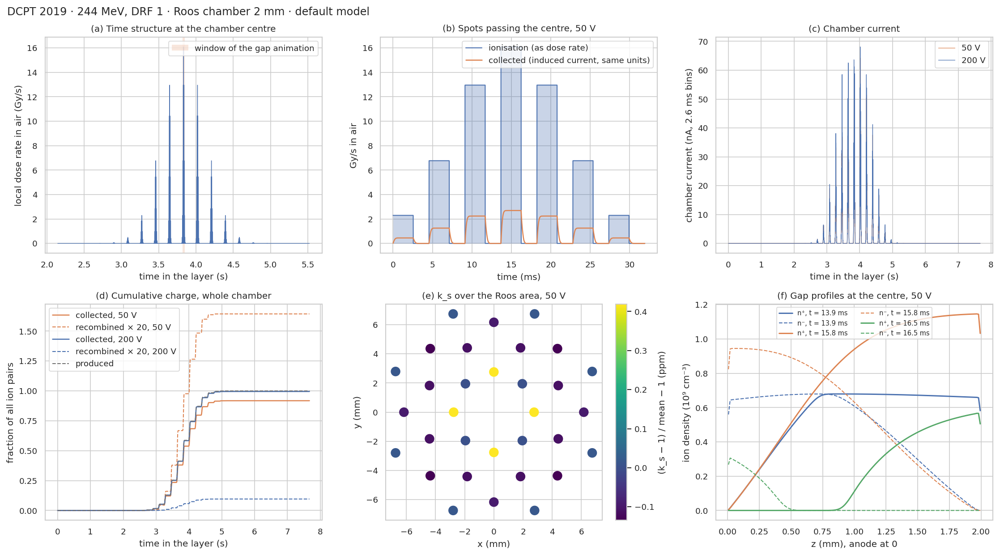
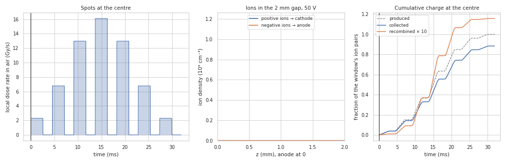
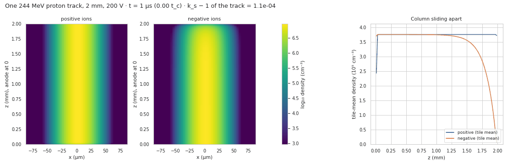
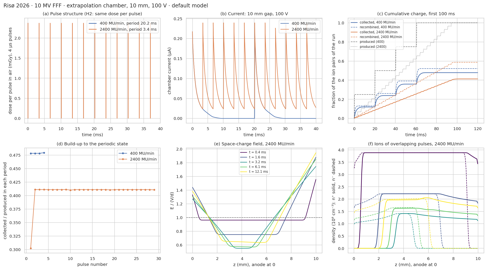
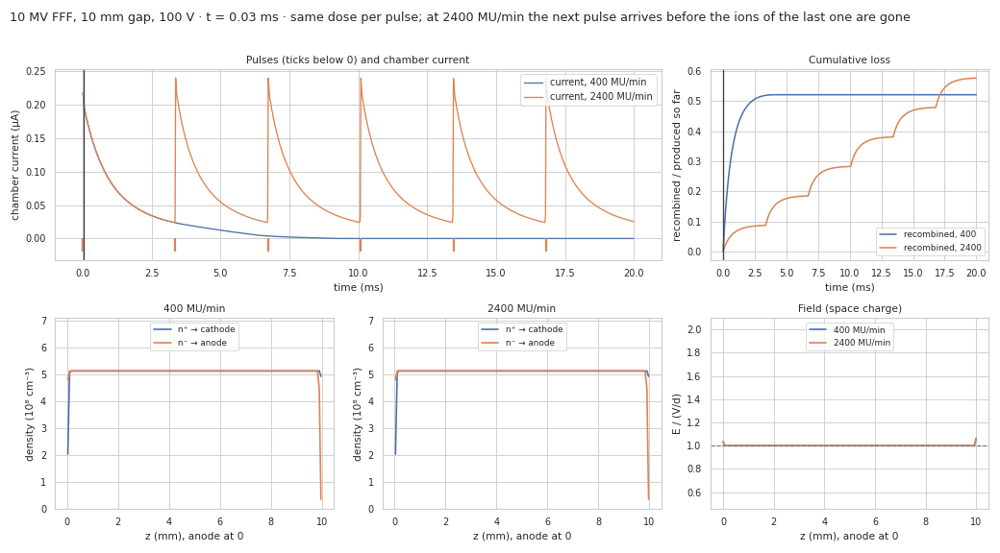

# Diagnostics: charge carriers in the chamber over time

Generated by `python validation/diagnostics.py` (106 s). All runs use the default model
(free electrons and space charge). The benchmarks themselves are in
[BENCHMARK_DCPT2019.md](BENCHMARK_DCPT2019.md) and [BENCHMARK_RISOE2026.md](BENCHMARK_RISOE2026.md).

## DCPT 2019 · 244 MeV protons, DRF 1, Roos chamber (2 mm)

(a) The local dose rate at the chamber centre over the whole 41 × 41 layer. Every spot within a
few σ adds a rectangular pulse, and the passing rows show up as groups. (b) The spots passing
closest to the centre, together with the charge collected at that point at 50 V. Collection
lags the ionisation by the ion transit time, and it falls short by the recombination loss.
(c) The chamber current over the layer at 50 and 200 V. (d) Cumulative produced, collected and
recombined charge for the whole chamber. Chamber k_s: 1.0896 at 50 V, 1.0048 at
200 V. (e) The variation of k_s − 1 over the Roos area at 50 V is below 10 ppm. With 2.5 mm spot
spacing and 3.8 mm σ, every point sees nearly the same sequence of spots, only shifted in time.
(f) Ion profiles at the centre: building up at the start of the closest spot, in steady state
during it, and draining after it.

**Ions in the gap while spots pass (50 V).** Each spot builds up the positive (drifting to the
cathode) and negative (drifting to the anode) ion profiles, and the gap drains in the dead time.

**One 244 MeV proton track (3D track model, 200 V).** The positive and negative columns slide
apart along the field while diffusion widens them. Recombination inside the track (initial
recombination) ends once they have separated. k_s − 1 of one track: 1.1e-04.

## Risø 2026 · 10 MV FFF, extrapolation chamber, 10 mm gap, 100 V (10 V/mm)

(a) The pulse structure under H2 (the same dose per pulse at both dose rates; see the benchmark).
(b) The chamber current. At 400 MU/min the current falls to zero before the next pulse. At
2400 MU/min it does not, because the next pulse arrives while the slow positive ions (transit
time 7.4 ms) are still in the gap. (c) Cumulative charge. (d) The collection efficiency of each
pulse period, in windows centred between pulses. At 400 MU/min every pulse is independent. At
2400 MU/min it settles from the second pulse on at a lower value, because each pulse now meets
the ions of the previous ones. The first window is only half a period long, which is why its
value is low. Efficiency
over the first 100 ms: 0.479 at 400 MU/min and 0.413 at 2400 MU/min.
(e) The space-charge field during the overlap, and (f) the ion profiles of successive pulses.

**Isolated against overlapping pulses.**

