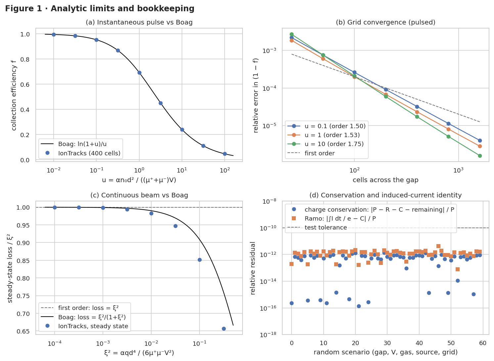
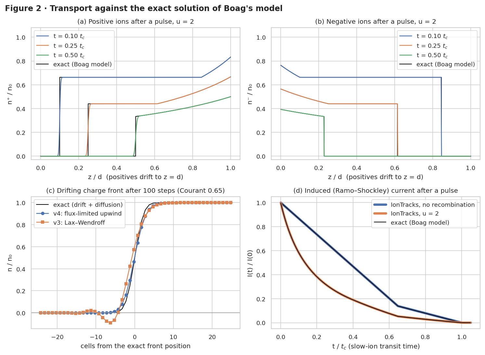
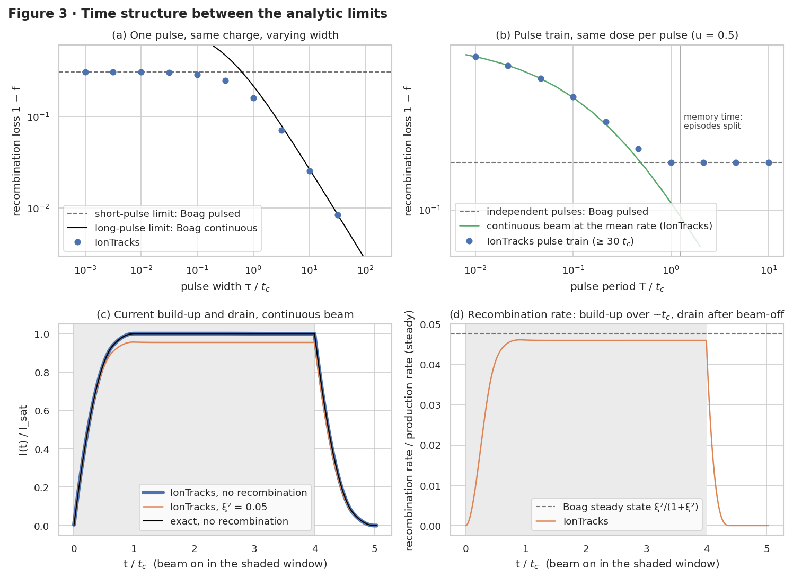
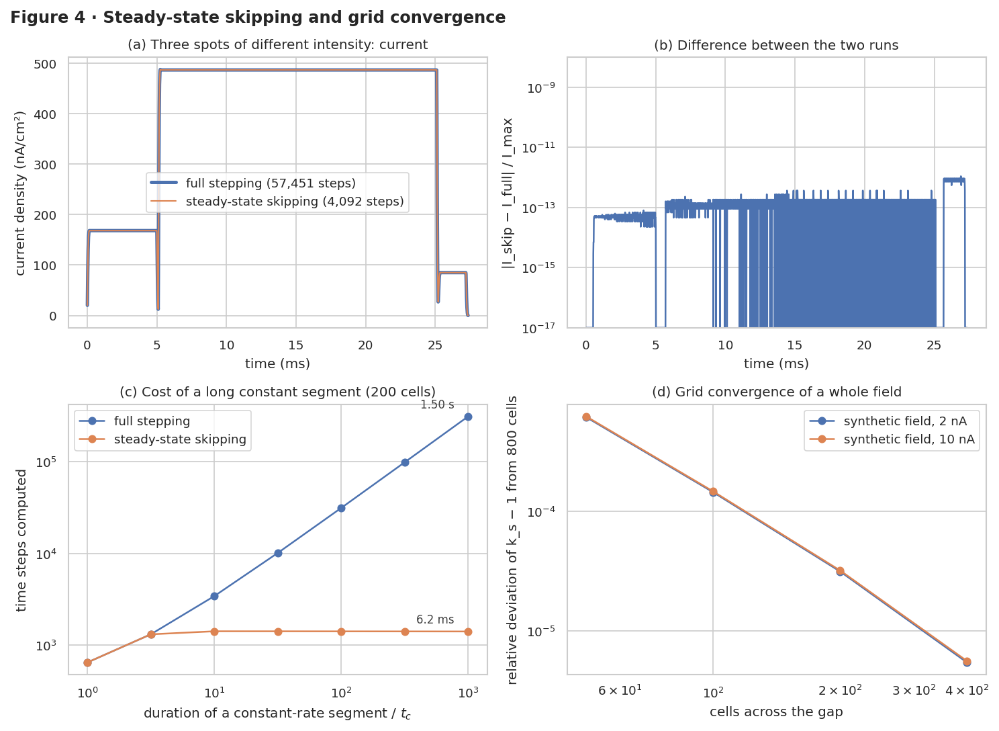
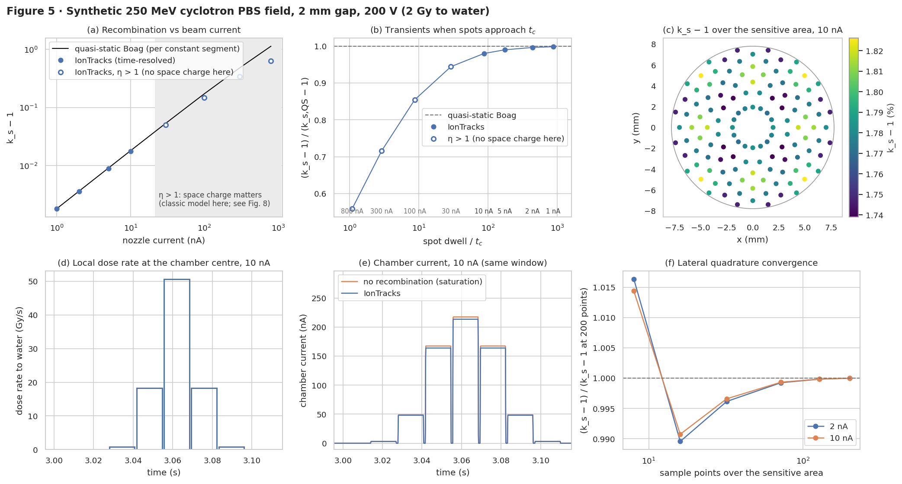
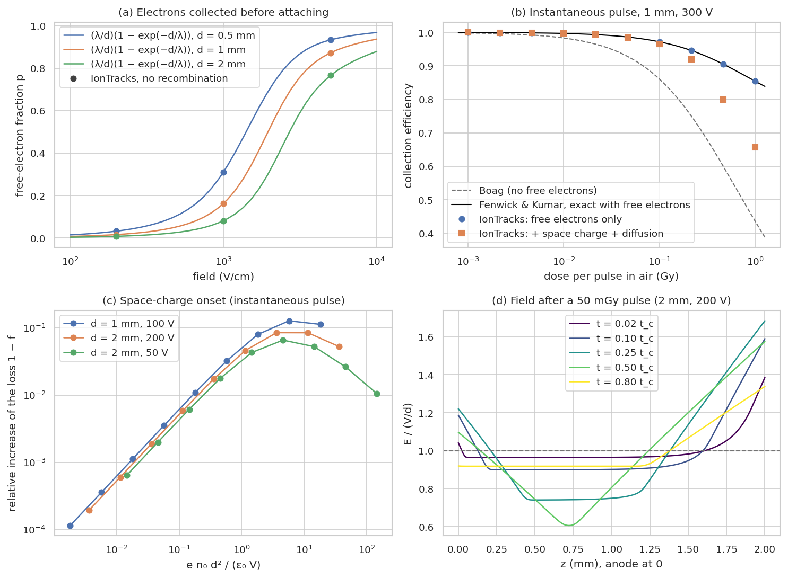

# IonTracks v4 validation

Generated by `python validation/run_validation.py` (78 s). **29 of 29 checks
pass.** Chamber for all runs unless stated: plane-parallel, 2 mm gap, 200 V, dry air with separate
ion mobilities (µ⁺ = 1.36, µ⁻ = 2.1 cm²/Vs). Comparisons against Boag's theories switch diffusion
off, because those theories neglect it.

| | Check | Value | Criterion |
|---|---|---|---|
| ✅ | Boag pulsed, max rel. error in (1-f), u = 0.01...100 | 7.46e-05 | <= 1.00e-03 |
| ✅ | Boag pulsed convergence order, u = 0.1 | 1.50 | >= 1.00 |
| ✅ | Boag pulsed convergence order, u = 1 | 1.53 | >= 1.00 |
| ✅ | Boag pulsed convergence order, u = 10 | 1.75 | >= 1.00 |
| ✅ | Boag continuous, \|loss/xi2 - 1\| at xi2 = 1e-4 | 1.40e-04 | <= 1.00e-03 |
| ✅ | max conservation residual (60 random scenarios) | 1.38e-12 | <= 1.00e-10 |
| ✅ | max Ramo residual (60 random scenarios) | 4.38e-12 | <= 1.00e-10 |
| ✅ | positive ion profiles, max relative L1 error vs exact | 7.89e-03 | <= 2.00e-02 |
| ✅ | negative ion profiles, max relative L1 error vs exact | 1.31e-03 | <= 2.00e-02 |
| ✅ | v4 scheme: minimum density at a front (must be >= 0) | 9.23e-64 | >= 0.00e+00 |
| ✅ | v3 Lax-Wendroff: minimum density at the same front (reference) | -8.96e-02 | (negative = unphysical) |
| ✅ | induced current vs exact, alpha = 0: max \|dI\| / I(0) | 1.11e-03 | <= 1.00e-02 |
| ✅ | induced current vs exact, u = 2: max \|dI\| / I(0) | 3.69e-04 | <= 1.00e-02 |
| ✅ | short pulse (1e-3 t_c): rel. deviation from Boag pulsed | 6.76e-05 | <= 1.00e-02 |
| ✅ | long pulse (100 t_c): rel. deviation from Boag continuous | 4.28e-03 | <= 3.00e-02 |
| ✅ | long period (10 t_c): rel. deviation from one simulated pulse | 0.00e+00 | <= 1.00e-09 |
| ✅ | short period (0.01 t_c): rel. deviation from continuous beam at the mean rate | 1.56e-04 | <= 3.00e-02 |
| ✅ | continuous switch-on/off current (alpha = 0) vs exact: max \|dI\| / I_sat | 2.06e-03 | <= 1.00e-02 |
| ✅ | steady-state skipping vs full stepping: max \|dI\| / I_max | 1.10e-12 | <= 1.00e-08 |
| ✅ | steady-state skipping vs full stepping: rel. difference in k_s - 1 | 7.91e-13 | <= 1.00e-09 |
| ✅ | synthetic field (2 nA): \|k_s-1\| change 200 -> 800 cells | 3.13e-05 | <= 1.00e-03 |
| ✅ | synthetic field 1 nA: rel. deviation of k_s-1 from quasi-static Boag | 1.37e-03 | <= 1.00e-02 |
| ✅ | synthetic field 1 nA: field-level conservation residual | 8.57e-14 | <= 1.00e-10 |
| ✅ | synthetic field 2 nA: rel. deviation of k_s-1 from quasi-static Boag | 3.50e-03 | <= 1.00e-02 |
| ✅ | synthetic field 2 nA: field-level conservation residual | 1.57e-14 | <= 1.00e-10 |
| ✅ | synthetic field (2 nA): \|k_s-1\| change 32 -> 200 sample points | 3.84e-03 | <= 1.00e-02 |
| ✅ | free-electron fraction vs exact, max rel. deviation | 1.55e-15 | <= 1.00e-10 |
| ✅ | free electrons vs Fenwick-Kumar exact, max rel. error in (1-f), 1 mGy-1 Gy | 6.49e-05 | <= 1.00e-03 |
| ✅ | space-charge effect at low density: \|log-log slope - 1\| | 0.020 | <= 0.100 |

## Figure 1 · Analytic limits and bookkeeping

(a) Instantaneous uniform pulse against Boag's exact ln(1+u)/u over four decades of u.
(b) The error falls faster than first order as the grid is refined.
(c) Steady-state loss of a continuous beam divided by ξ². It tends to 1 (first-order Boag) for
small ξ². For large ξ² it falls below Boag's 1/(1+ξ²) formula, which is itself only first-order
accurate.
(d) Charge conservation and the Ramo identity (∫I dt equals the collected charge) hold to round-off
for 60 random chambers, gases, grids and sources.

## Figure 2 · Transport against the exact solution of Boag's model

(a, b) After an instantaneous pulse with drift and recombination (no diffusion), the model has a
closed-form solution: inside the overlap region n = n₀/(1+αn₀t), and outside it the density is
frozen at the moment the ion left the overlap. The simulated profiles follow it. The negative
ions (Courant 1) shift exactly; the positive ions show slight smoothing at the front.
(c) A drifting charge front: the v4 flux-limited scheme stays within [0, 1], while the v3
Lax–Wendroff scheme under- and overshoots.
(d) The induced current agrees with the current computed from the exact profiles, with and without
recombination.

## Figure 3 · Time structure between the analytic limits

(a) One pulse of fixed charge, stretched from 10⁻³ to 10² collection times. The solver moves
continuously from Boag's pulsed limit to Boag's continuous limit.
(b) A pulse train with fixed dose per pulse (u = 0.5). For long periods it gives exactly the
single-pulse value, because episodes are split and deduplicated at the memory time. For short
periods it approaches a continuous beam at the same mean rate. That reference is computed by the
solver, because at these mean rates ξ² ≫ 1 and Boag's first-order continuous formula no longer
applies. The overlap regime in between is where neither Boag formula applies (Brualla-González
et al. 2016).
(c) A continuous beam switched on and off. With recombination off, the current matches the exact
build-up and drain.
(d) The recombination rate builds up over about one collection time to Boag's steady state, and
recombination continues while the gap drains.

## Figure 4 · Steady-state skipping and convergence

(a, b) Three spots of different intensity. Skipping steady-state stretches gives the same current
as stepping every step, to round-off.
(c) Cost: without skipping it grows linearly with segment length; with skipping it is constant.
(d) Grid convergence of k_s for the whole synthetic field.

## Figure 5 · Synthetic 250 MeV cyclotron PBS field

(a) k_s − 1 against nozzle current. At clinical currents it matches Boag's continuous theory
applied to every constant segment. Above about 30 nA the peak local dose rate makes η > 1, so space
charge matters. Those points (hollow, shaded) use the classic model here; Figure 8 covers
space charge.
(b) The ratio to the quasi-static estimate as a function of spot dwell time: when spots last only a
few collection times, build-up and drain reduce recombination.
(c) k_s over the sensitive area. The pattern follows the 5 mm spot grid: points under a spot row
see higher instantaneous dose rates.
(d, e) The dose-rate history at the centre and the chamber current while spots pass. The gap
between the saturation current and the simulated current is the recombination loss.
(f) Convergence with the number of lateral sample points.

## Figure 8 · Free electrons and space charge

(a) Electrons that reach the anode before attaching (attachment data of Götz et al. 2013, as
tabulated by Fenwick & Kumar 2023). The attachment kernel reproduces (λ/d)(1 − exp(−d/λ)) to
round-off.
(b) Collection efficiency of an instantaneous pulse. With free electrons, a uniform field and no
diffusion, the model reproduces the exact solution of Fenwick & Kumar (2023). Adding space charge
and diffusion (the default model) lowers the efficiency at high dose per pulse.
(c) The relative space-charge increase of the loss is proportional to e n₀ d² / (ε₀ V), which is
`space_charge_parameter_pulsed`.
(d) The separating ion clouds screen the field in the middle of the gap. The field grows near the
electrodes, while the mean field stays V/d.

Figures 1–5 compare with Boag's classic theories and therefore use the model without free
electrons or space charge. The track model (initial recombination, overlapping tracks) is
validated in [VALIDATION_TILE3D.md](VALIDATION_TILE3D.md). For the blind comparisons with
measurements, see
[BENCHMARK_DCPT2019.md](BENCHMARK_DCPT2019.md) (scanned protons) and
[BENCHMARK_RISOE2026.md](BENCHMARK_RISOE2026.md) (pulsed electrons and photons).
