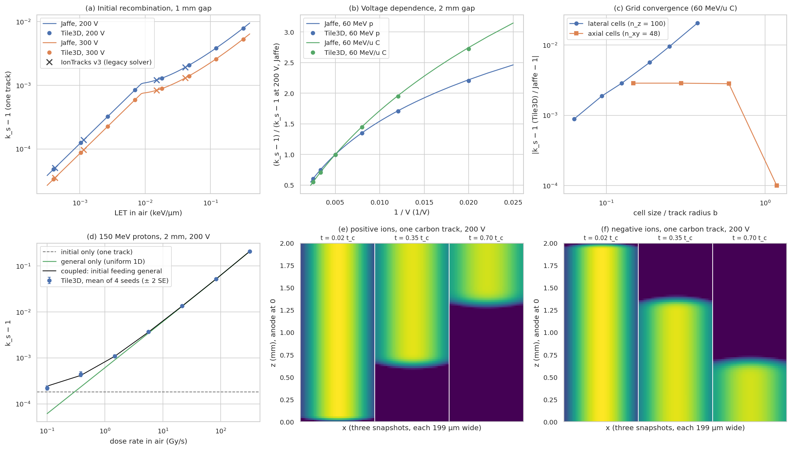

# Track-resolved 3D model (Tile3D): validation

Generated by `python validation/validate_tile3d.py` (189 s). **6 of
6 checks pass.**

`Tile3D` simulates one lateral sample point as a periodic tile of the gap. Ion tracks cross the gap
perpendicular to the electrodes, at Poisson-distributed times and positions. Each track is a
Gaussian column: N0 ion pairs per cm, radius b from the IonTracks v3 LET table (floor 20 µm). The
ions drift along z, diffuse in 3D and recombine. Free electrons and space charge (mean field along
z) are those of the 1D model.

| | Check | Value | Criterion |
|---|---|---|---|
| ✅ | single track vs Jaffe, max rel. deviation of k_s-1 (g <= 0.05) | 2.94e-03 | <= 2.00e-02 |
| ✅ | single track vs IonTracks v3 (8 cases), max rel. deviation of k_s-1 | 7.24e-03 | <= 3.00e-02 |
| ✅ | single track vs Jaffe over 50-400 V (2 mm), max rel. deviation of k_s-1 | 7.74e-03 | <= 2.00e-02 |
| ✅ | lateral convergence order towards Jaffe (last 4 grids) | 1.67 | >= 0.80 |
| ✅ | Tile3D vs coupled model where tracks overlap (>= 20 Gy/s), max rel. deviation | 2.93e-03 | <= 1.00e-02 |
| ✅ | Tile3D vs coupled model at all rates, max |difference| / SE (4 seeds) | 1.68 | <= 3.00 |

(a) Initial recombination of one track against Jaffé's theory for a column parallel to the field.
The comparison uses the IonTracks v3 gas constants (one mobility, one diffusion coefficient), as
Jaffé's theory assumes. Crosses are the eight single-track results of the legacy v3 solver
(`validation/data/iontracks_v3/`). Jaffé's prescribed-diffusion approximation (the column keeps its
Gaussian shape) holds for weak recombination, g = αN0/(8πD) ≪ 1. At high LET the
simulation departs from it, as found by Christensen et al. (2016).
(b) The 1/V dependence of initial recombination, normalised to Jaffé at 200 V.
(c) Convergence towards Jaffé as the cells shrink relative to the track radius.
(d) A continuous 150 MeV proton beam at rising dose rate (default physics: free electrons and
space charge). At low rates every track recombines alone and k_s − 1 is the single-track value.
At high rates the tracks overlap and general recombination takes over. The coupled model
(the surviving fraction of each track, f_init, feeding the uniform 1D solver:
k_s = 1 / (f_init f_general(q f_init))) follows the full 3D simulation, which validates the
coupling used for scanned-field benchmarks.
(e, f) The positive and negative columns of one carbon track slide apart along the field, which
ends their recombination. Diffusion widens them in the meantime.

## Single tracks against Jaffé (1 mm gap)

| V | LET in air (keV/µm) | g | k_s − 1, Jaffé | k_s − 1, Tile3D | difference |
|---|---|---|---|---|---|
| 200 | 0.000398 | 2.02e-04 | 4.8290e-05 | 4.8185e-05 | -0.22% |
| 200 | 0.00103 | 5.25e-04 | 1.2535e-04 | 1.2508e-04 | -0.22% |
| 200 | 0.00268 | 1.36e-03 | 3.2538e-04 | 3.2464e-04 | -0.23% |
| 200 | 0.00696 | 3.53e-03 | 8.4452e-04 | 8.4244e-04 | -0.25% |
| 200 | 0.0181 | 9.18e-03 | 1.2967e-03 | 1.2934e-03 | -0.26% |
| 200 | 0.0469 | 2.38e-02 | 2.0708e-03 | 2.0647e-03 | -0.29% |
| 200 | 0.122 | 6.18e-02 | 3.8483e-03 | 3.8339e-03 | -0.37% |
| 200 | 0.316 | 1.61e-01 | 7.9031e-03 | 7.8599e-03 | -0.55% |
| 300 | 0.000398 | 2.02e-04 | 3.3775e-05 | 3.3703e-05 | -0.21% |
| 300 | 0.00103 | 5.25e-04 | 8.7675e-05 | 8.7486e-05 | -0.21% |
| 300 | 0.00268 | 1.36e-03 | 2.2758e-04 | 2.2708e-04 | -0.22% |
| 300 | 0.00696 | 3.53e-03 | 5.9072e-04 | 5.8933e-04 | -0.23% |
| 300 | 0.0181 | 9.18e-03 | 8.9052e-04 | 8.8829e-04 | -0.25% |
| 300 | 0.0469 | 2.38e-02 | 1.4068e-03 | 1.4028e-03 | -0.28% |
| 300 | 0.122 | 6.18e-02 | 2.6013e-03 | 2.5926e-03 | -0.34% |
| 300 | 0.316 | 1.61e-01 | 5.3299e-03 | 5.3056e-03 | -0.45% |

## From initial to general recombination (panel d)

| dose rate in air (Gy/s) | k_s − 1, Tile3D (mean of 4 seeds) | standard error | k_s − 1, coupled model | ratio |
|---|---|---|---|---|
| 0.1 | 2.2319e-04 | 1.2e-05 | 2.4370e-04 | 0.916 |
| 0.383 | 4.4202e-04 | 2.7e-05 | 4.1757e-04 | 1.059 |
| 1.47 | 1.0985e-03 | 4.1e-05 | 1.0839e-03 | 1.014 |
| 5.62 | 3.6987e-03 | 6.7e-05 | 3.6386e-03 | 1.017 |
| 21.5 | 1.3423e-02 | 8.3e-05 | 1.3463e-02 | 0.997 |
| 82.5 | 5.1831e-02 | 1.1e-04 | 5.1781e-02 | 1.001 |
| 316 | 2.0823e-01 | 2.3e-04 | 2.0807e-01 | 1.001 |

With few tracks per tile at low rates, the general part of the recombination scatters between
seeds, and the coupled model agrees within the statistics. Where tracks overlap strongly, the two
agree to better than 1 %.

## Limitations

* Tracks are perpendicular to the electrodes. Oblique tracks (Jaffé's angle dependence) are not
  implemented.
* The track radius b is an effective, empirical input: the v3 table after Rossomme et al., with a
  20 µm floor that applies to all protons. No independent data constrain it here.
* The periodic tile carries the images of every track. By default it spans three track widths
  after one slow-ion transit; the images then meet only at low density, and (c) shows that the
  lateral cell size, not the tile size, sets the accuracy.
* Space charge acts through the laterally averaged field. The lateral field of a single track
  (below 0.1 V/cm for protons, ~10 V/cm for heavy ions) is neglected.
